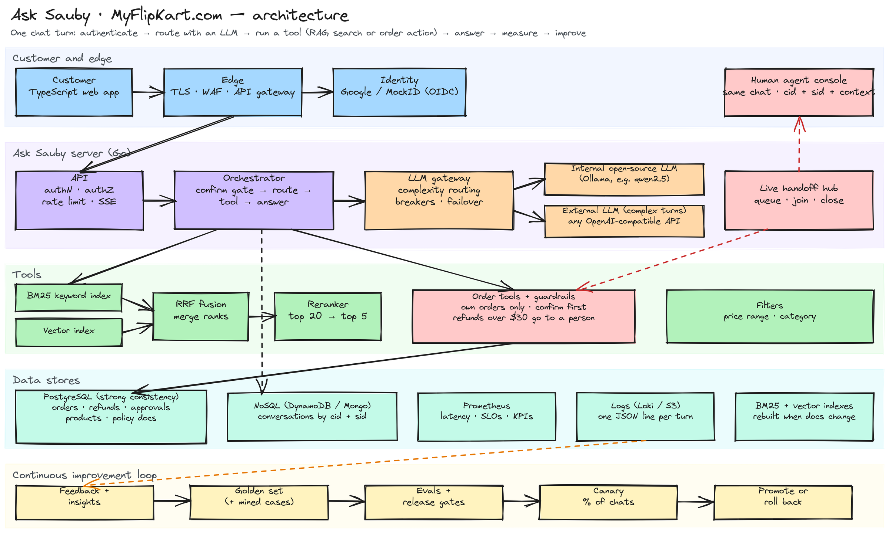

# Ask Sauby — a learning project for AI support agents

Ask Sauby is the shopping assistant for **MyFlipKart.com**, a fictional store. It is built to teach the whole life of an AI support agent, end to end:

- hybrid RAG search (BM25 + vectors) with fusion and reranking;
- an LLM router that picks tools;
- guarded order actions such as refunds;
- human handoff;
- metrics, evals and a loop for shipping better agents.

**▶ [Try the live demo](https://asksauby.onrender.com)** · **[Watch a request flow through the system](https://bktechmission.github.io/myflipkart/)**: an animated walkthrough of search, refunds and human handoff.



<sub>Diagram source: [`docs/architecture.excalidraw`](docs/architecture.excalidraw). Open it at [excalidraw.com](https://excalidraw.com) to edit.</sub>

---

## How one chat turn works

1. **Edge.** The browser talks HTTPS to the edge. TLS terminates there, and the WAF, gateway and rate limits screen traffic before any LLM is paid for.
2. **Identity.** Customers sign in with Google (OpenID Connect, code + PKCE). The server verifies the RS256 ID token against Google's keys and sets a signed, HttpOnly session cookie. The session maps to a **customer id (cid)**.
3. **Save first.** The message is written to the conversation store under **cid + session id (sid)** before anything else.
4. **Route.** The orchestrator asks the **LLM gateway** which tool fits. Simple turns go to an internal open-source model (Ollama). Complex turns can go to an external OpenAI-compatible provider. Each provider has a circuit breaker and fails over to the other. If no LLM is up, a rule-based router takes over.
5. **Retrieve.** For product and policy questions, **BM25** (exact words, model names) and a **vector index** (meaning) search in parallel.
   - **Reciprocal Rank Fusion** merges the two lists: `1/(60+rank₁) + 1/(60+rank₂)`.
   - A **reranker** re-scores the top 20 down to 5.
   - Price and category become metadata filters.
6. **Act safely.** Order tools (track, list, buy, cancel, return, replace, refund, complain) only ever see the session's own orders.
   - Nothing changes until the customer says *yes*.
   - **No refund without the item.** A refund is released only when the warehouse scans the returned item (or a teammate confirms it never arrived).
   - Returns over **$29**, and any return beyond **3 in 30 days**, are handed to a person **in the same chat, right away**, with the reason ("above the $29 automatic limit", "3 returns already this month").
   - The teammate **investigates before approving**: unused, defective or used? All accessories? Above **$150** ($300 for loyal customers) they ask for a **photo**, uploaded in the chat. The server refuses an approval without a recorded condition, or without a photo above the threshold. Used items that aren't faulty are declined, with the warranty offered instead.
   - **Customer standing:** loyal customers (5+ orders, few returns) get a higher photo threshold. Declined requests, missing-item claims or a high return rate put an account on *watch* (every return goes to a person) or *blocked* (new orders are reviewed too).
   - **Seller standing:** low ratings, a high return rate or repeated complaints flag a seller. Suspended sellers are hidden from search and can't take orders.
   - A **replacement** is offered before a return. Orders over $1000, more than 3 orders a day, and replacements over $500 get a teammate review. Stock is checked under the lock, so the last unit is never sold twice.
   - Seller complaints and missing items go straight to a person. Answering **No** to "Did this solve your issue?" connects a teammate immediately.
   - Each action is one transaction, re-checked under the lock, and one refund per order, ever.
7. **Answer.** The LLM writes FAQ answers from the retrieved passages only. Money and order outcomes use fixed templates. Status lines stream first ("Checking refund eligibility…"), so the customer is never staring at silence.
8. **Measure.** Every turn emits Prometheus metrics and one JSON log line. Logs and feedback feed the eval loop.

### Human handoff

When a customer asks for a person, Sauby opens a **live ticket** carrying cid, sid, a summary and the customer's context. The chat switches to *waiting*, and Sauby stops answering.

A support agent picks the ticket in **Admin → Live chats**. They see the transcript, recent orders and pending approvals, and join **the same chat window**. Their messages are written to the same cid + sid conversation. When the agent closes the ticket, Sauby takes over again and asks for feedback.

For demos, if nobody joins within a few seconds, a **simulated teammate** joins instead (`SIM_AGENTS=1`). It reads the context, can approve a held refund, and answers using the same tools. Simulated teammates are always labeled **Demo** in the customer's chat. Software should never be presented to customers as a real person.

### Data stores

The demo runs on one machine with no infrastructure. Each component sits behind the same boundary the production store would.

| Concern | Production choice | Demo implementation |
|---|---|---|
| Orders, refunds, approvals, tickets | **PostgreSQL**, row locks | Write-ahead log (`data/wal.jsonl`, fsync'd before replying) |
| Product pages and policy docs | **PostgreSQL** (+ CDN for images) | Same WAL. Images are generated SVGs |
| Conversations | **NoSQL** (DynamoDB / MongoDB), key `cid + sid` | `data/conversations/<cid>/<sid>.jsonl` |
| Search indexes | OpenSearch / pgvector / FAISS (HNSW) | In-memory BM25 + flat cosine, rebuilt live when docs change |
| Metrics | **Prometheus** + Grafana | `GET /metrics` (Prometheus text format) |
| Logs | **Loki / Elasticsearch / S3** | JSON lines on stdout + `data/events.jsonl` |

## What we measure

| Area | Metrics |
|---|---|
| Retrieval | precision@5, recall@5, hit@5, MRR, nDCG@10, overall and by query type (keyword, semantic, price, policy) |
| Routing | tool confusion matrix, per-tool precision / recall / F1, argument accuracy |
| Outcomes | resolution, deflection, handoff, escalation, recontact within 72 h, CSAT, feedback response rate, per agent version |
| Safety | no cross-customer leaks, confirm before commit, returns over $29 handed to a person, condition + photo required to approve, grounded answers, exactly-once refunds under concurrency |
| Ops | p50 / p95 / p99 per path against SLOs (FAQ p95 < 1 s, p99 < 5 s; orders and refunds p95 < 5 s, p99 < 30 s), time to first status, availability against 99.99%, handoff wait, tokens and cost |

### Evals and release gates

```bash
make eval          # retrieval + router + end-to-end suites, then release gates
make eval-llm      # judge the LLM router instead of the rule router
make gate          # what CI runs: exits 1 if any gate fails
```

Gates live in [`backend/evals/gates.json`](backend/evals/gates.json). A new agent version ships only if every gate passes, and several are zero-tolerance (leaks, confirm-before-commit, escalation).

**Example the evals caught:** adding page-text and rating signals to the reranker lowered recall@5 from 1.000 to 0.987. Those signals are now off. See [`backend/internal/search/rerank.go`](backend/internal/search/rerank.go).

**Be honest with the numbers:** the rule router scores 100% because its patterns were written next to the golden set. Mined cases from real traffic, and `make eval-llm`, give the realistic picture.

### Continuous improvement loop

1. **Collect:** turns, feedback (asked after every resolution, escalation and handoff), and handoff transcripts.
2. **Mine:** Admin → Insights lists zero-result searches, handoff questions, thumbs-down chats and failed actions.
3. **Fix knowledge:** Admin → Knowledge edits policy docs and product pages. BM25 and vectors rebuild on save, live.
4. **Label:** use **Add to golden set** on any failure so every future agent is tested on it.
5. **Build a candidate:** prompt, model, or retrieval knobs (`RRF_K`, `POLICY_K`, `RERANK`, embeddings).
6. **Gate:** `make gate` must pass.
7. **Canary:** `CANARY_PERCENT=10 CANARY_LLM_MODEL=qwen2.5:7b` pins 10% of chats to the candidate. Compare control and canary on Admin → Business.
8. **Promote or roll back:**
   - promote when gates pass and resolution, CSAT, recontact and SLOs are no worse;
   - roll back immediately on any leak or wrong refund.

---

## Run it on a Mac

```bash
# 1. Tools (one time)
brew install go node
brew install ollama            # optional: the open-source LLM

# 2. Get the code
git clone https://github.com/bktechmission/myflipkart.git
cd myflipkart

# 3. Create .env with fresh random secrets (never committed)
make setup

# 4. Build the UI and start everything
make dev                       # MockID on :9000, Ask Sauby on http://localhost:8080
```

Open http://localhost:8080 (or the [live demo](https://asksauby.onrender.com)) → **Continue with a demo account** → pick a customer:

| Demo account | Role | Has orders |
|---|---|---|
| aarav@example.com | admin + customer | yes |
| meera@example.com | customer | yes |
| sam@example.com | customer | no |

The admin console is at http://localhost:8080/admin.

To get the LLM path, run this in a second terminal and restart `make dev`:
```bash
ollama serve
ollama pull qwen2.5:3b && ollama pull nomic-embed-text
```

### Things to try

- "Headphones for long flights", then open **How I found this** to see BM25, vector, fused and rerank positions.
- "Laptops between $500 and $1000"
- "Where is my latest order?"
- "Tell me about P1020", then "place order this"
- "What hasn't been delivered yet?"
- "Return O5009" (under $29: label now, refund when the item arrives — or tap **Send a free replacement instead**)
- "I want a refund for O5008" (over $29: a teammate joins the chat, asks about the item's condition and approves)
- Return something over $150 as Meera: the teammate asks for a photo; tap the camera button to share one.
- Admin → Approvals → **Returns on the way back** → *Mark received* to simulate the warehouse scan that releases a refund.
- "The seller sent me a fake item on O5005" (complaint: a teammate joins)
- "Talk to a person". Then open Admin → Live chats in another window and join, or wait for the Demo teammate.
- Sign in as Meera and ask for order O5001. You won't see it: it's Aarav's.

### Real Google sign-in

1. In Google Cloud Console → APIs & Services → Credentials, create an **OAuth client ID** (Web application).
2. Add the authorized redirect URI `http://localhost:8080/auth/callback`.
3. Put `GOOGLE_CLIENT_ID` and `GOOGLE_CLIENT_SECRET` in `.env`. Optionally set `DEMO_ORDERS_FOR=<your email>` to get a copy of the demo orders, and add yourself to `ADMIN_EMAILS`.

MockID, the local demo provider in `backend/cmd/mockidp`, speaks the same OpenID Connect protocol, so both use one code path. It is labeled as a local tool and is not affiliated with Google.

## Host it for free on Render

The live demo runs at **https://asksauby.onrender.com** on Render's free tier, from the same [`Dockerfile`](Dockerfile) and the [`render.yaml`](render.yaml) Blueprint.

[](https://render.com/deploy?repo=https://github.com/bktechmission/myflipkart)

1. Click the button, or go to **Render → New → Blueprint** and pick this repo, then click **Apply**. Render builds the image. `SESSION_SECRET` is generated by Render and never stored in git.
2. *(Optional)* custom domain:
   - In the service's **Settings → Custom Domains**, add `asksauby.yourdomain.com`.
   - In your DNS (e.g. Cloudflare), add a `CNAME` from `asksauby` to `<service>.onrender.com`. Set it to **DNS only** (grey cloud) so Render can issue the certificate.

Free services sleep after about 15 idle minutes. The next visit takes ~30–60 s to wake up and starts with fresh demo data, which keeps a public demo clean. The demo uses the rule router (no LLM cost). To add an LLM, set `INTERNAL_LLM_URL`, `INTERNAL_LLM_MODEL` and `INTERNAL_LLM_API_KEY` (any OpenAI-compatible API) in the service's Environment.

## Or host it on Cloudflare (Workers Paid)

The public demo runs as **one Cloudflare Worker in front of one Container**:

```
browser → Cloudflare edge (TLS, WAF, rate limits) → Worker (cloudflare/src/index.ts) → Container: Go server :8080
```

- **One image** ([`Dockerfile`](Dockerfile)): the Go server, the compiled UI, and the demo sign-in. The sign-in is embedded at `/mockid` (`MOCK_EMBEDDED=1`), so the whole app lives on one URL.
- **No secrets to manage.** Session and sign-in secrets are generated in memory at start. Nothing is baked into the image.
- **Self-resetting.** Container disk is ephemeral. After 30 idle minutes the container sleeps, and the next visitor gets fresh demo data.
- **Public-demo guards** (`PUBLIC_DEMO=1`):
  - demo accounts only;
  - rate limits per browser session;
  - one eval run per minute;
  - a daily LLM-token cap per account.

**Requirements:** a Cloudflare account on the **Workers Paid** plan (Containers need it), and nothing to install on your Mac. GitHub Actions builds and deploys the image.

### Deploy with GitHub Actions (recommended)

1. **Cloudflare dashboard → My Profile → API Tokens → Create Token.** Start from the *Edit Cloudflare Workers* template for your account. If the first deploy reports a missing container permission, edit the token and add the Containers permission. Copy the token and your **Account ID** (shown on the Workers overview page).
2. **GitHub → repo Settings → Secrets and variables → Actions:**
   - Secrets: `CLOUDFLARE_API_TOKEN`, `CLOUDFLARE_ACCOUNT_ID`
   - Variable: `DEPLOY_CLOUDFLARE` = `true`
3. **Actions → deploy-cloudflare → Run workflow.** The first deploy takes a few minutes while the image builds and rolls out. The app is then live at `https://asksauby.<your-subdomain>.workers.dev`. Later pushes to `main` that touch the app redeploy it automatically.

### Turn on the LLM (optional)

Without an LLM, the demo uses the rule router: free and deterministic. To show real tool calling with **Workers AI** (OpenAI-compatible, so the existing gateway works unchanged):

1. Create a second API token with **Workers AI: Read**.
2. Add it as the GitHub secret `WORKERS_AI_TOKEN` and re-run the workflow.

The default model is `@cf/meta/llama-3.3-70b-instruct-fp8-fast`. Override it with the Worker secret `WORKERS_AI_MODEL`. If a model replies in prose instead of calling a tool, Sauby falls back to the rule router for clear tasks. Run the evals against the model you pick before sharing widely.

### Deploy from your Mac instead

Needs Docker Desktop running:

```bash
cd cloudflare && npm install
npx wrangler login
npx wrangler deploy
npx wrangler secret put WORKERS_AI_TOKEN   # optional, plus CF_ACCOUNT_ID
```

### Keep a public demo healthy

- Add a **WAF rate-limiting rule** (e.g. 60 requests per minute per IP on `/api/chat`).
- Add **Turnstile** on `/login` if you see bots.
- Watch **Workers → asksauby → Observability**.
- Admin is open to anyone who signs in as the demo admin, which is intentional for learning. Edits vanish when the container sleeps.
- Google sign-in is off in the public demo unless you add `GOOGLE_CLIENT_ID` / `GOOGLE_CLIENT_SECRET` and register `https://<your-host>/auth/callback` with Google.

## Security notes

- **No secrets in git.** `make setup` writes random `SESSION_SECRET` and `MOCK_IDP_CLIENT_SECRET` values to `.env`, which is git-ignored. If `SESSION_SECRET` is missing, the server generates a random one per run instead of falling back to a default.
- **Authentication.** OIDC with PKCE, state and nonce. RS256 only, verified against JWKS, with issuer, audience and expiry checks.
- **Authorization.** Roles (guest / customer / admin) plus per-order ownership enforced inside the tools. Another customer's order returns 404, not 403.
- **CSRF.** SameSite cookies plus a required `X-Sauby` header on writes.
- **Response headers.** Strict CSP, `frame-ancestors 'none'`, and HSTS on https.
- **Limits.** A token bucket per customer, plus a daily LLM-token quota.
- **Metrics.** `/metrics` is loopback-only unless `METRICS_TOKEN` is set.

## Project layout

```
backend/                Go, standard library only
  cmd/server            the app
  cmd/mockidp           local OpenID Connect provider (demo accounts)
  internal/mockid       the demo IdP itself (standalone, or embedded at /mockid)
  cmd/evals             eval runner + release gates
  internal/agent        orchestrator, routers, tools, guardrails, answers
  internal/llm          LLM gateway (internal/external, breakers, failover)
  internal/search       BM25, vectors, RRF, reranker, filters, live re-index
  internal/live         human handoff: queue, agent console, simulated teammates
  internal/store        transactions (WAL), conversations (cid+sid), telemetry
  internal/auth         OIDC, JWT verification, signed sessions
  internal/api          HTTP: auth, chat (SSE), admin, metrics
  internal/obs          Prometheus metrics + JSON logs
  internal/evals        retrieval / router / e2e suites, gates
web/                    TypeScript UI (chat, orders, shop, admin), light + black themes
docs/                   GitHub Pages walkthrough + Excalidraw architecture
cloudflare/             Worker + Container config for the public demo
Dockerfile              one image: server + UI + embedded demo sign-in
```

---

Developed by **Bhupender Kumar Panwar** · Product Manager: **Saurabh Dahake**

Licensed under the [MIT License](LICENSE). Third-party components (the Instrument Sans font is SIL OFL 1.1) are listed in [THIRD_PARTY_NOTICES.md](THIRD_PARTY_NOTICES.md). MyFlipKart.com and its products, customers and orders are fictional.
