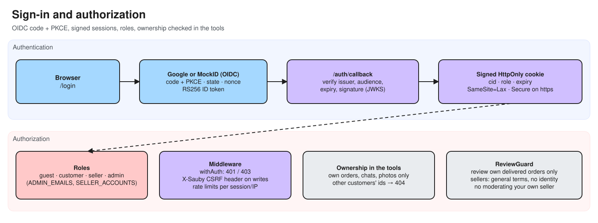

# Auth

Source: [auth.excalidraw](auth.excalidraw) (generated by `docs/tools/make_diagrams.py`).

## Packages

| Package | Role |
|---|---|
| `internal/auth` | OIDC client (code + PKCE, state, nonce), RS256 JWT verification against JWKS, signed sessions |
| `internal/mockid` | the demo OpenID Connect provider (standalone or embedded at `/mockid/`) |
| `cmd/mockidp` | runs MockID on :9000 for local development |

## Flow

1. `GET /login` lists providers from `GET /auth/providers` (Google when configured, MockID demo accounts).
2. `GET /auth/login` sets a signed state cookie and redirects to the provider with PKCE.
3. `GET /auth/callback` checks state, exchanges the code, verifies the ID token (issuer, audience, expiry, nonce, signature), finds or creates the customer, and sets a signed HttpOnly session cookie with the role.
4. `POST /auth/guest` gives a short guest session (no orders, no reviews). `POST /auth/logout` clears the cookie.
5. `GET /api/me` returns who is signed in. Static files: `GET /dist/`, `GET /static/`.

Roles: **guest**, **customer**, **seller** (`SELLER_ACCOUNTS`, e.g. `seller@example.com=SoundNest Store`), **admin** (`ADMIN_EMAILS`).

## Guards

- RS256 only; issuer, audience and expiry checked; PKCE + state + nonce.
- Sessions are HMAC-signed, HttpOnly, SameSite=Lax, Secure on https; secrets are random per run when not configured.
- Writes need the `X-Sauby` header (CSRF); cross-site sign-in posts are blocked by Fetch Metadata.
- Ownership lives in the tools (orders, chats, photos, reviews); other customers' ids return 404.
- ReviewGuard: sellers see their reviews only in general terms and can't moderate cases about themselves (see [reviewguard.md](reviewguard.md)).

## Failure modes

| Failure | What happens |
|---|---|
| Provider unreachable | back to `/login` with a message |
| Tampered or expired cookie | treated as signed out (401 on APIs) |
| Missing `SESSION_SECRET` | a random one per run: sessions reset on restart, never a guessable default |
| Login floods | per-IP rate limit on sign-in |
