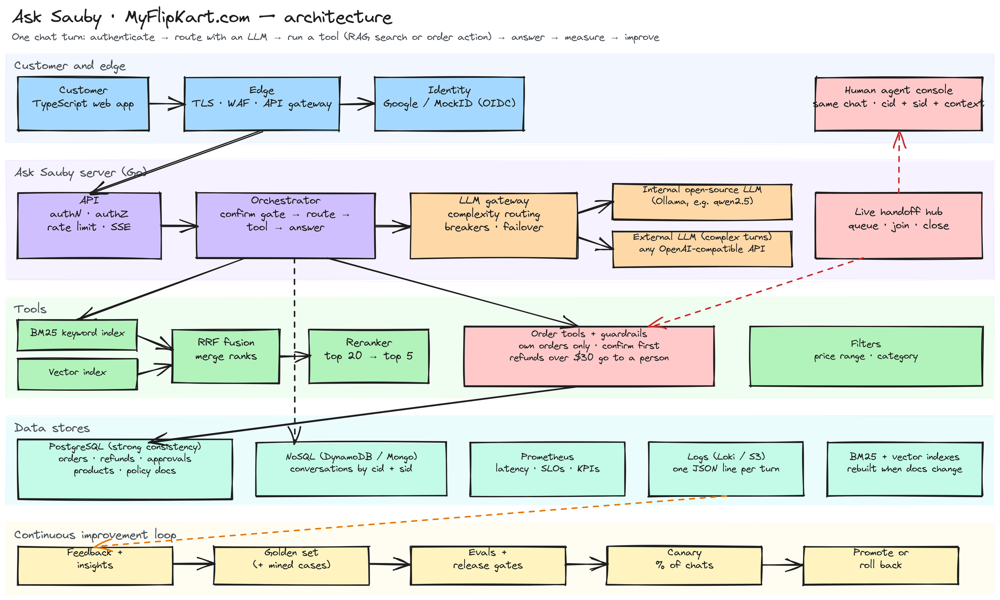

# Ask Sauby chat

The shopping and support assistant: hybrid RAG search, an LLM router that picks tools,
guarded order actions, human handoff.

Source: [../architecture.excalidraw](../architecture.excalidraw) (generated by `docs/tools/make_architecture.py`).
Walkthrough: [a chat turn, animated](https://bktechmission.github.io/myflipkart/).

## Packages

| Package | Role |
|---|---|
| `internal/agent` | orchestrator: confirm gate → route (LLM or rules) → tool → answer; order tools and guardrails; customer and seller standing |
| `internal/search` | BM25 + vector indexes, Reciprocal Rank Fusion, reranker, price/category filters, live re-index |
| `internal/llm` | LLM gateway: internal and external OpenAI-compatible providers, circuit breakers, failover |
| `internal/live` | human handoff: live tickets, the agent console, simulated teammates (labelled Demo) |
| `internal/api` | HTTP: sessions, chat over SSE, admin endpoints, rate limits, security headers |
| `internal/img` | generated product SVGs |
| `internal/config` | every knob from the environment |
| `cmd/server` | the app binary |

## Request flow (one chat turn)

1. `POST /api/chat` with the session cookie and `X-Sauby` header. Rate limit per browser session, daily token quota.
2. The user message is saved to the conversation (cid + sid) before anything else.
3. If a person owns the chat (`GET /api/sessions/{sid}/live` shows it), Sauby stays silent and the message goes to them.
4. Router: LLM tool call through the gateway, or the rule router when no LLM is up (`ROUTER=rules` on the free demo).
5. Tool: search (BM25 + vectors → RRF → rerank → filters) or an order action (own orders only, dry run first, "yes" commits in one transaction).
6. Answer: grounded LLM text for FAQs, fixed templates for money and orders. Status lines stream first over SSE.
7. Metrics and one JSON log line per turn.

## Routes

| Route | Purpose |
|---|---|
| `GET /{$}` | the chat app (sign-in required) |
| `POST /api/chat` | one turn, streamed as Server-Sent Events |
| `POST /api/feedback` | thumbs up/down; "not solved" brings in a person now |
| `GET /api/sessions`, `POST /api/sessions`, `GET /api/sessions/{sid}` | the customer's conversations (sid bound to the cid by HMAC) |
| `GET /api/sessions/{sid}/live` | live-chat state while a person owns the chat |
| `POST /api/sessions/{sid}/photo`, `GET /api/photos/{cid}/{id}` | photos for a teammate (re-encoded, owner-only) |
| `GET /api/orders`, `GET /api/orders/{id}` | the customer's own orders (others → 404) |
| `GET /api/products`, `GET /img/{file}`, `GET /p/{id}` | catalog, product images, product page (rating from [ReviewGuard](reviewguard.md)) |
| `GET /admin` | admin console |
| `GET /api/admin/approvals`, `POST /api/admin/approvals/{id}` | refunds, returns and orders held for a person |
| `POST /api/admin/orders/{id}/receive` | warehouse scan that releases a refund |
| `POST /api/admin/reset-orders` | reset demo data (orders and reviews) |
| `GET /api/admin/knowledge`, `PUT /api/admin/policies/{id}`, `PUT /api/admin/products/{id}` | edit knowledge, re-index live |
| `GET /api/admin/live`, `POST /api/admin/live/{id}/join`, `POST /api/admin/live/{id}/message`, `POST /api/admin/live/{id}/close` | the human agent console |

## Guards

- Own orders only, checked inside the tools; another customer's order is 404.
- Confirm before commit; one refund per order, ever; stock checked under the lock.
- No refund without the item; returns over $29 or beyond 3 in 30 days go to a person, who must record the condition (and see a photo above the threshold).
- Customer standing (loyal / watch / blocked) and seller standing (watch / suspended, including ReviewGuard strikes and delisted products).
- Simulated teammates are always labelled Demo.

## Failure modes

| Failure | What happens |
|---|---|
| LLM down or slow | circuit breaker opens after 3 failures; failover to the other provider; then the rule router |
| LLM answers in prose | rule router for clear tasks |
| Crash mid-action | the WAL record is written before the change applies; replay on start; a torn last line is skipped |
| Two refunds at once | one lock, re-checked at commit: exactly one |
| Nobody joins a handoff | a Demo teammate joins after `SIM_JOIN_AFTER_SEC` (demo only) |
| Traffic flood | per-session and per-IP token buckets, daily token quota, edge WAF |
