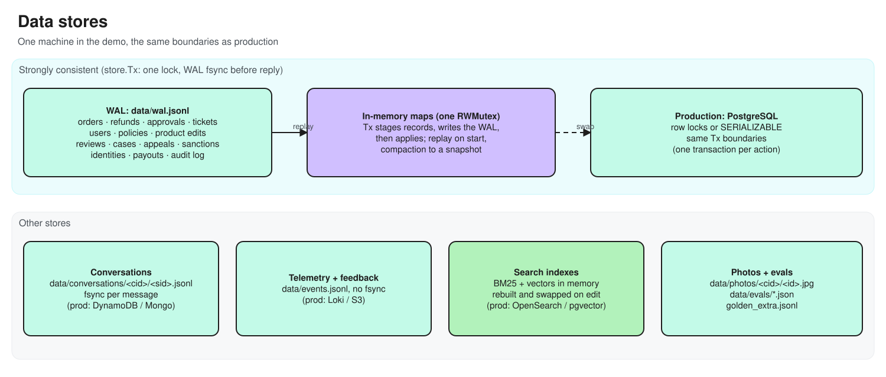

# Data stores

Source: [data-stores.excalidraw](data-stores.excalidraw) (generated by `docs/tools/make_diagrams.py`).

## Packages

| Package | Role |
|---|---|
| `internal/store` | the WAL-backed transactional store, conversations, telemetry, photos; ReviewGuard records in `reviews.go` |
| `internal/model` | shared domain types (orders, refunds, tickets, reviews, cases, appeals, audit) |
| `internal/seed` | the synthetic catalog, demo users and orders, policy docs, golden chat set; product sellers |

## Flow

1. `store.Tx(fn)` takes the write lock, runs `fn` against a staged view, writes every staged record to `data/wal.jsonl` and **fsyncs**, then applies them. Nothing is visible, and nobody is told "done", before the fsync.
2. On start the WAL is replayed (a torn last line is skipped) and compacted to a snapshot.
3. Conversations are appended per message to `data/conversations/<cid>/<sid>.jsonl` with fsync; telemetry goes to `data/events.jsonl` without fsync (cheap, eventual).

| Concern | Demo | Production |
|---|---|---|
| Orders, refunds, approvals, tickets, reviews, cases, appeals, sanctions, audit | WAL + maps, one lock | PostgreSQL, row locks or SERIALIZABLE |
| Conversations | JSONL per cid/sid | DynamoDB / MongoDB keyed by cid + sid |
| Search indexes | in-memory BM25 + vectors, swapped on edit | OpenSearch / pgvector |
| Metrics, logs | `/metrics`, stdout + events.jsonl | Prometheus, Loki / S3 |

## Guards

- One transaction per action; every check is repeated under the lock at commit.
- Keys are validated (`cid`, `sid`, photo ids) so paths can't escape the data directory.
- A store read must never happen inside a `Tx` (the lock isn't re-entrant): read through the `Txn`.
- Synthetic demo shoppers have ids starting with `S` and orders with `SO`; reset removes them.

## Failure modes

| Failure | What happens |
|---|---|
| Crash before fsync | the change never happened and nobody was told it did |
| Crash after fsync, before apply | replay applies it |
| WAL write fails | the transaction returns the error; nothing changes |
| Disk is ephemeral (free hosting) | the demo restarts with fresh seed data |
