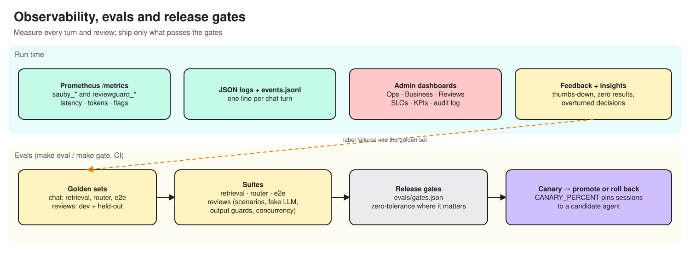

# Observability and evals

Source: [observability-evals.excalidraw](observability-evals.excalidraw) (generated by `docs/tools/make_diagrams.py`).

## Packages

| Package | Role |
|---|---|
| `internal/obs` | Prometheus-format metrics registry and JSON logs |
| `internal/evals` | retrieval, router, e2e and reviews suites; release gates (`backend/evals/gates.json`) |
| `internal/testkit` | fresh in-memory store, retriever and tools for tests |
| `cmd/evals` | `make eval`, `make eval-llm`, `make gate` |

## Routes

| Route | Purpose |
|---|---|
| `GET /metrics` | Prometheus scrape (loopback only unless `METRICS_TOKEN`) |
| `GET /healthz` | health, router and LLM provider state |
| `GET /api/admin/metrics` | Ops and Business dashboards (SLOs, KPIs, per agent version) |
| `GET /api/admin/evals/latest`, `GET /api/admin/evals/history`, `POST /api/admin/evals/run` | run evals from the admin page |
| `GET /api/admin/insights`, `GET /api/admin/transcripts/{cid}/{sid}`, `POST /api/admin/golden` | mine failures and label them into the golden set |
| `GET /api/admin/search` | probe retrieval after a knowledge edit |

## Flow

1. Every chat turn and every review decision emits metrics (`sauby_*`, `reviewguard_*`) and log/event lines.
2. Admin dashboards read them: Ops, Business, Reviews (queue, latency per path, LLM share, cost, overturn rate, audit log).
3. Failures become golden cases; `make gate` runs every suite; CI fails if any gate fails.
4. A candidate agent goes to a canary slice of sessions; promote only if gates pass and live KPIs are no worse.

## ReviewGuard gates

auto-reject precision ≥ 99%, 0 honest negatives hidden, 0 seller-linked or unverified reviews counted,
0 false flags on a genuine viral day, 100% of invented quotes and rule ids rejected, plus action
accuracy, adversarial recall, injection, star-blindness, output guards, fail-safe, LLM path,
exactly-once and latency. Golden cases come in a **dev** split (written next to the rules, so its
scores are optimistic) and a **held-out** split (written independently; its `heldout_*` gates apply
once it has cases).

## Failure modes

| Failure | What happens |
|---|---|
| A suite didn't run | its gates are reported as skipped, not passed silently |
| Overfitting to the golden set | held-out split and mined cases from real traffic; `make eval-llm` for the LLM router |
| Metrics endpoint exposed | loopback only unless a bearer token is set |
