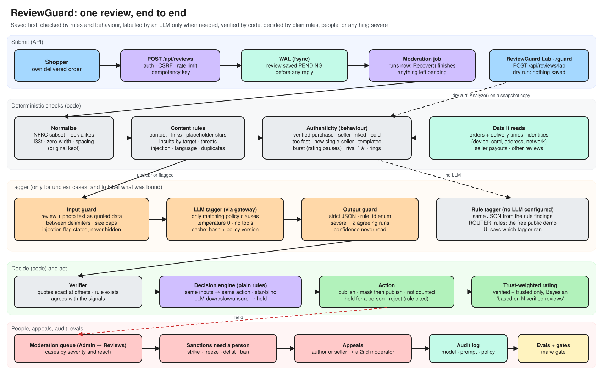

# ReviewGuard

Real reviews on MyFlipKart products, guarded end to end: abusive or unsafe wording is caught,
fake, paid and seller-driven reviews are detected by behaviour, an LLM labels reviews against
written rules (with guarded input, rules and output), people decide anything severe, and sellers
can't harm each other or the store.



Source: [reviewguard.excalidraw](reviewguard.excalidraw) (generated by `docs/tools/make_diagrams.py`).
Walkthrough: [one review, step by step](https://bktechmission.github.io/myflipkart/reviewguard.html).

## Packages and files

`internal/reviews` (all ReviewGuard logic), records in `internal/store/reviews.go`, types in `internal/model/review.go`, HTTP in `internal/api/reviews.go`.

| File | Role |
|---|---|
| `policy/policy.json`, `policy.go` | the versioned policy library: rule ids, definitions, examples, counter-examples, allowed severities |
| `normalize.go` | NFKC subset (the repo is standard-library only), look-alike letters, l33t, zero-width and spacing tricks, with offsets back to the original |
| `content.go` | contact info, links, placeholder slurs, insults by target, quoted/reported speech, threats, prompt injection, language, masking |
| `authenticity.go` | verified purchase, seller-linked, paid, too fast, new single-seller, templated, burst, rival 1★, rings |
| `tagger.go` | rule tagger and the guarded LLM tagger; strict JSON parser; cache |
| `verify.go` | the verifier |
| `decide.go` | the decision engine |
| `rating.go` | trust-weighted rating |
| `guard.go` | submit, process exactly once, reassess, recover, case grouping |
| `moderation.go` | case decisions, sanctions, appeals, reports, the Demo second moderator |
| `simulate.go` | demo scenarios on synthetic data |
| `eval.go`, `fake.go`, `golden/` | eval harness, scripted fake LLM, dev and held-out golden sets |
| `metrics.go` | admin metrics |

## Request flow

1. **Submit.** `POST /api/reviews` (signed in, `X-Sauby`, rate limit 8/min per customer) with stars, text and an idempotency key.
   The order must be the customer's own and delivered, contain the product, and not be reviewed yet. The review is saved
   **PENDING through the WAL (fsync) before any reply**; a retry with the same key returns the same review.
2. **Moderation job.** Runs right after the save in the same request. `Recover()` at start-up finishes anything a crash left
   pending. The move from pending to an outcome is a compare-and-set under the store lock: never lost, never acted on twice.
   (In production this is a queue worker; the contract is the same.)
3. **Normalize** and run the **content rules** on the original and normalized text.
4. **Authenticity** from behaviour only: orders and delivery times, identities (device, card, address, network) of reviewers
   and seller staff, seller payouts, other reviews.
5. **Tagger**, only when something was found or the wording is unclear. With an LLM configured: the LLM tagger through the
   existing gateway. Without one (`ROUTER=rules`, the free demo): the rule tagger, same JSON. The UI says which ran.
6. **Verifier** checks every label. **Decision engine** picks the action. One transaction writes the outcome, files the review
   into a case if a person must look, and appends to the audit log.
7. **People** decide cases in Admin → Reviews; authors and sellers appeal; a second moderator decides.

## Routes

| Route | Who | Purpose |
|---|---|---|
| `GET /p/{id}` | anyone | product page: trusted rating ("based on N verified reviews"), published reviews, the review form |
| `GET /api/reviews/mine` | customer | my reviews (outcome, rule cited, appeal) and orders I can review |
| `POST /api/reviews` | customer | submit |
| `POST /api/reviews/{id}/appeal` | author | appeal a rejected, removed or not-counted review, once |
| `GET /seller` | seller | the seller page |
| `GET /api/seller/reviews` | seller | trusted ratings; not-counted reviews grouped by reason, in general terms (no reviewer identity) |
| `POST /api/seller/appeals` | seller | appeal a reason group |
| `POST /api/seller/reports` | seller | report a review: opens a case, never hides or un-counts it |
| `GET /api/admin/reviews` | admin | queue, appeals, ratings (trusted vs naive), metrics, audit log, latest eval |
| `GET /api/admin/reviews/policy` | admin | the policy library |
| `GET /api/admin/reviews/cases/{id}` | admin | evidence, labels with quotes, tagger, versions, suggested action |
| `POST /api/admin/reviews/cases/{id}` | admin | approve or dismiss with a note, plus opt-in sanctions |
| `POST /api/admin/reviews/appeals/{id}` | admin | uphold or overturn (not the first decider) |
| `POST /api/admin/reviews/appeals/{id}/demo` | admin | Demo second moderator (`SIM_AGENTS=1` only, labelled simulated) |
| `POST /api/admin/reviews/sim` | admin | demo scenarios: `fake5`, `rival1`, `viral`, `abuse`, `reset` (synthetic data) |

## The LLM tagger's contract

```json
{"labels":[{"rule_id":"RG-C3","severity":"medium","quotes":[{"text":"idiot","start":17,"end":22}]}],
 "target":"self|other|product","notes":"short"}
```

- **Input guard:** the review and photo text are quoted data between `<<<REVIEW … REVIEW>>>` (delimiters inside the text are
  escaped), capped at 1500 and 300 characters; the deterministic injection flag and signals are stated in the prompt.
- **Rules guard:** the prompt holds only the policy clauses matching this review; `rule_id` must come from that enum.
- **Output guard:** strict JSON. Unknown fields (including any self-reported confidence), trailing text, missing fields
  or bad enums reject the whole answer. Temperature 0. Cached by content hash + policy + prompt version. A severe label
  needs two agreeing runs.
- **No power:** no tools, no actions, never rewrites text. Offsets are Unicode character offsets.

## Verifier

A label survives only if its rule exists in the current policy (and was offered), its severity is allowed, every quote is
the review's exact text at its offsets, and it agrees with the signals: lexicon rules (contact, links, slurs, threats,
injection) need a detector hit on the quote; an insult can't be quoted speech or aimed at a product or the author. A
discarded label, or a slur/insult/threat the rules found but the tagger didn't confirm, holds the review for a person.

## Decision engine

| Action | When | Counted |
|---|---|---|
| publish | nothing found, or only allowed wording (harsh but honest, quoted abuse, self-deprecation) | if verified and trusted |
| mask then publish | phone, email or link: masked by code | if verified and trusted |
| not counted | shown, but unverified, or during a burst pause, or one medium behaviour signal | no |
| hold | unclear wording in rules mode, injection, unsupported language, a discarded label, an LLM-only judgment, LLM down/slow/unsure, strong or combined behaviour signals | no |
| reject | a reject-class rule (insult at a person, placeholder slur, threat) with a deterministic detector hit the tagger confirmed | no |

The engine never reads the star rating for content rules: the same words get the same action at 1★ and 5★, and an honest
negative review is always published and counted (FTC 2024 consumer-review rule). Behaviour definitions that do involve stars
(a paid 5★, a rival's 1★) are about payments and links, not sentiment.

## Ratings

`shown = (5 × category mean + Σ trusted stars) / (5 + n)`, over published, counted reviews. During a burst the rating stays at
its last trusted value until a person clears it; a person can also freeze it. Admins see the naive average next to it.

## Guards (people and sellers)

- Seller strikes, rating freezes, delisting and customer bans are applied only by a person deciding a case; simulated
  moderators can't apply them. Strikes feed seller standing (3 = suspended); delisted products leave search and ordering.
- A moderator linked to a seller (by `SELLER_ACCOUNTS`) can't decide cases about that seller or its products.
- Appeals are decided by someone other than the first decider.
- Sellers see not-counted reviews only as date, stars and a reason group. A seller's report never changes a review on its own.
- Every engine and human step is in the audit log with tagger, model, prompt and policy versions.

## Failure modes

| Failure | What happens |
|---|---|
| Crash after the PENDING save | `Recover()` decides it on start, exactly once |
| Concurrent submits / retries | idempotency key + compare-and-set: one review, one decision |
| LLM down, slow (4 s budget) or unsure | hold for a person; nothing is auto-rejected without evidence; clear reviews still publish |
| LLM hallucinates quotes or rules | the verifier discards the label; the review is held |
| Prompt injection in a review | flagged, stated in the prompt, held for a person; the model has no tools to misuse |
| Seller buys reviews / rival attacks | not counted, grouped into one case ("12 reviews on … linked to SoundNest Store"), rating unaffected |
| Genuine viral day | deliveries explain the reviews: no burst, no flags (an eval gate) |
| Overfitting the golden set | dev vs held-out split; held-out gates apply once it has cases |

Known limits: normalization covers the compatibility ranges reviews use, not all of NFKC; links spelled with spaces
("example . com") aren't caught; the rule tagger can't judge new insults or slurs it has no word for, so in rules
mode name-calling and dehumanizing language without a known word wait for a person (an LLM label alone never
auto-rejects); reviews in languages other than English and Hinglish are held for a person who reads them; there is
no rule yet for promotion or solicitation (referral codes, "DM me"), only links and contact details are masked.
The held-out set measures these gaps (see `make eval`).

## Evals

`make eval` / `make gate` run the `reviews` suite (see [observability-evals.md](observability-evals.md)). Synthetic data only:
demo shoppers, sellers and orders are made up, and placeholder words (zorkoid, blorfin, snargle) stand in for slurs.
